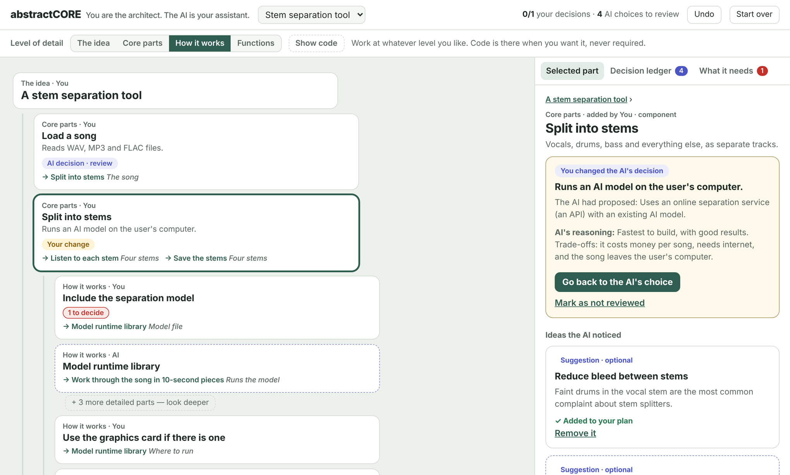
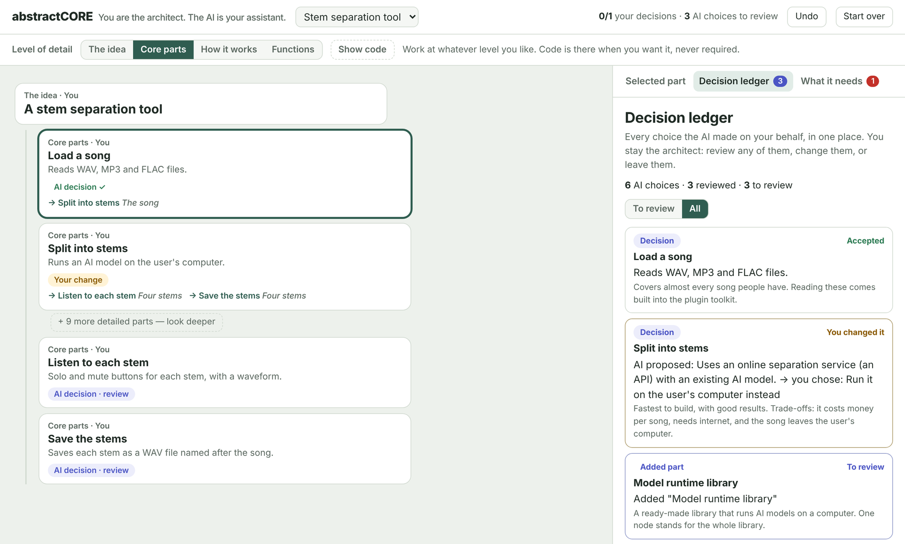

# abstractCORE

**You are the architect. The AI is your assistant.**

abstractCORE is a development pipeline where you engineer a system at whatever level of detail you choose, and the AI works beneath you. You decide what the system is and how it fits together. The AI fills in what you leave open, and every choice it makes stays on the record. You can review it, change it, or leave it. You never have to touch code unless you want to.

**[▶ Try the live demo](https://belovedtemitope.github.io/abstractCORE/demo/)** · [Landing page](https://belovedtemitope.github.io/abstractCORE/) · [Original prototypes](#prototypes)



## The problem

AI can now write software faster than people can read it. That leaves two bad options: review every line, or trust a codebase you don't understand. abstractCORE adds a third: **abstention without losing control**. You step back from the code, but not from the decisions.

It does this with two ideas:

- **Levels of abstraction.** A system is one graph of nested parts, from the idea down to functions and code. Work at any level. Deeper layers fold away until you choose to look.

  | Level | You see | Example |
  |---|---|---|
  | The idea | What it's for | "A stem separation tool" |
  | Core parts | The major parts and how they relate | Load a song → Split into stems → Listen / Save |
  | How it works | Behaviour and data flow | Model file → runtime library → 10-second pieces → stems |
  | Functions | Units of work, with code inside | `run(model, chunk)`. Optional, never required |

- **A decision ledger.** Every choice the AI made for you sits in one place, with its reasoning and alternatives. That includes approaches it picked, defaults it applied when you skipped a question, and parts it added that you never described. Each entry is marked *to review*, *accepted* or *you changed it*. That is your high-level overview of the whole system.



## How decisions are split

| | Who decides | What happens |
|---|---|---|
| **You must decide** | Only you: product, business, legal | The AI will not guess. Nothing is built around the gap. |
| **Question** | You, if you want | Skip it and the AI uses a stated default, recorded in the ledger. |
| **AI decision** | The AI proposes, you rule | Accept it, or pick an alternative. The parts beneath reshape to match. |
| **Suggestion** | Optional | Something the AI noticed. Add it or dismiss it. |

## What's in this repository

| Path | What it is | Status |
|---|---|---|
| [`src/`](src) | **The graph core.** Zero-dependency TypeScript engine: layered nodes, flow edges, conditional parts, decisions, ledger, needs, level-of-detail views, validation, audit log. | Working, tested |
| [`demo/`](demo) | **Architect view.** Interactive web app running on the core. [Live](https://belovedtemitope.github.io/abstractCORE/demo/). | Working |
| [`examples/`](examples) | Two sample projects as `.acore.json` files, one from each prototype, running on the same engine. | Working |
| [`schema/`](schema/abstractcore.schema.json) | JSON Schema for the project file format. | v0.1 |
| `acore` CLI | `status`, `tree --depth N`, `ledger`, `next`, `answer`, `skip`, `accept`, `override`, `mermaid`, `validate`. | Working |
| [`prototype/`](prototype) | The two original interactive prototypes the core was extracted from. | Preserved as-is |

The AI in the demo is a **prepared sample**: the AI's decisions are already in the example files. Live model integration, where you describe intent and an LLM proposes the graph, is the next milestone. See [ROADMAP.md](ROADMAP.md).

## Quick start

```bash
git clone https://github.com/BelovedTemitope/abstractCORE && cd abstractCORE
npm install && npm run build

node dist/cli.js status  examples/stem-splitter.acore.json
node dist/cli.js tree    examples/stem-splitter.acore.json --depth 1
node dist/cli.js override examples/stem-splitter.acore.json split 0   # run on the user's computer instead
node dist/cli.js ledger  examples/stem-splitter.acore.json
```

```
A stem separation tool (you)
└ Load a song (you)  [AI decision]
    ↳ Reads WAV, MP3 and FLAC files.
└ Split into stems (you)  [your change]  (+8 more detailed)
    ↳ Runs an AI model on the user's computer.
└ Listen to each stem (you)  [AI decision]
└ Save the stems (you)  [AI decision]
```

As a library (npm package coming; for now import from `dist/`):

```ts
import { load, answer, overrideDecision, ledger, status, toMermaid } from "./dist/index.js";

let p = load(json);
p = answer(p, "idea", "platform", "web");      // every operation returns a new project
p = overrideDecision(p, "split", 0);           // and appends to the audit log
ledger(p);                                     // every AI choice and whether you reviewed it
status(p).openMust;                            // what still needs you
toMermaid(p, { maxDepth: 1 });                 // diagram at the level of detail you want
```

Run the tests with `npm test`. Rebuild the demo with `npm run demo`.

## Prototypes

The first explorations, kept unchanged. Their two models, broad-to-specific questions and an AI-completed graph with labelled decisions, are what `src/` unifies.

- [`prototype/idea-tree`](https://belovedtemitope.github.io/abstractCORE/prototype/idea-tree/): describe a product from broad to specific (sample: online clothing store).
- [`prototype/idea-graph-studio`](https://belovedtemitope.github.io/abstractCORE/prototype/idea-graph-studio/): Ideas and System lenses (sample: stem separation tool).

## Documentation

- [docs/architecture.md](docs/architecture.md): the model and how the engine works
- [ROADMAP.md](ROADMAP.md): what exists and what's next
- [CONTRIBUTING.md](CONTRIBUTING.md)

## License

[Apache License 2.0](LICENSE) © 2026 Beloved Temitope
